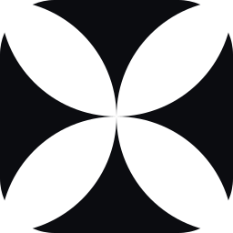
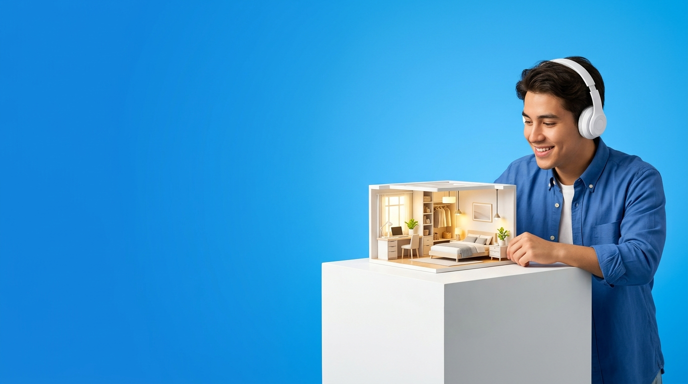
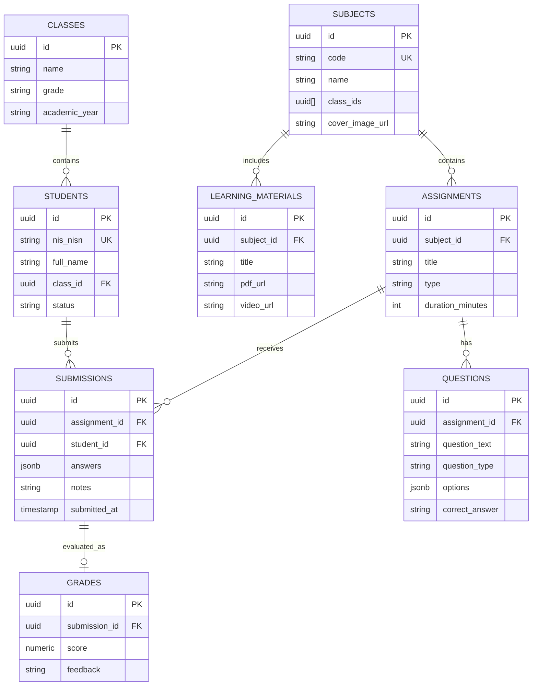

<div align="center">

  

  # **Marhas LMS**
  ### **Modern Learning Platform and Digital School Ecosystem**
  **SMK Marhas Margahayu - Bandung, Jawa Barat, Indonesia**

  <p align="center">
    Platform Learning Management System (LMS) modern, responsif, dan presisi tinggi yang menggabungkan estetika editorial kontemporer, scrolling inersia ultra-smooth <b>Lenis Engine</b>, arsitektur kartu berlapis <b>Layered Card</b> dengan tipografi <b>Handcrafted SVG Glass Filter</b>, serta basis data relasional awan <b>Supabase PostgreSQL</b>.
  </p>

  <p align="center">
    <a href="https://vercel.com/new/clone?repository-url=https%3A%2F%2Fgithub.com%2Fusername%2Fnexora-lms&env=VITE_SUPABASE_URL,VITE_SUPABASE_ANON_KEY&project-name=marhas-lms&repo-name=marhas-lms">
      
    </a>
  </p>

  <p align="center">
    <a href="https://vitejs.dev/"></a>
    <a href="https://react.dev/"></a>
    <a href="https://www.typescriptlang.org/"></a>
    <a href="https://tailwindcss.com/"></a>
    <a href="https://lenis.darkroom.engineering/"></a>
    <a href="https://motion.dev/"></a>
    <a href="https://supabase.com/"></a>
    <a href="https://lucide.dev/"></a>
    <a href="https://vercel.com/"></a>
    <a href="LICENSE"></a>
  </p>

  <p align="center">
    <a href="#ringkasan-eksekutif">Ringkasan Eksekutif</a> |
    <a href="#fitur-unggulan">Fitur Unggulan</a> |
    <a href="#panduan-deployment-ke-vercel">Deploy ke Vercel</a> |
    <a href="#arsitektur-dan-teknologi">Teknologi</a> |
    <a href="#struktur-proyek">Struktur Berkas</a> |
    <a href="#skema-database-supabase-postgresql">Database</a> |
    <a href="#panduan-instalasi-lokal">Instalasi Lokal</a> |
    <a href="#kredensial-akun-demo">Akun Demo</a>
  </p>

  <br />

  <a href="https://marhas.sch.id/">
    
  </a>

</div>

---

## Ringkasan Eksekutif

Marhas LMS dikembangkan untuk mentransformasi ekosistem kegiatan belajar mengajar (KBM) digital di SMK Marhas Margahayu menjadi lebih terstruktur, intuitif, dan nyaman digunakan baik oleh dewan guru maupun para siswa:

1. **Kecepatan Akses Sub-Detik**: Dibangun menggunakan Vite 6 dan React 18 dengan optimasi pembagian chunk (code splitting) dan hardware acceleration sehingga waktu muat halaman berlangsung instan tanpa flicker.
2. **Kenyamanan Kognitif (Ergonomic UX)**: Akses langsung dokumen modul PDF (1-click direct download), bilah pencarian cerdas spotlight multi-entity search, dan eliminasi 100% dialog konfirmasi native yang monoton.
3. **Ketahanan Data Relasional**: Terkoneksi secara aman dengan Supabase PostgreSQL yang menangani data riil puluhan siswa aktif, pembagian kelas rombel, repositori bank soal, serta evaluasi penilaian.
4. **Pengalaman Scroll Presisi**: Mengadopsi Lenis smooth scroll engine pada laptop/desktop, serta mode sentuh native 120Hz pada perangkat mobile.

---

## Panduan Deployment ke Vercel

Marhas LMS dirancang **100% siap produksi (Production-Ready)** untuk dideploy ke [Vercel](https://vercel.com/) dalam hitungan menit tanpa konfigurasi rumit.

### Opsi 1: One-Click Deploy Button (Direkomendasikan)
Klik tombol di bawah ini untuk mengkloning dan mendeploy proyek langsung ke akun Vercel Anda:

[](https://vercel.com/new/clone?repository-url=https%3A%2F%2Fgithub.com%2Fusername%2Fnexora-lms&env=VITE_SUPABASE_URL,VITE_SUPABASE_ANON_KEY&project-name=marhas-lms&repo-name=marhas-lms)

---

### Opsi 2: Deploy Manual via Vercel Dashboard

1. **Buka Vercel Dashboard**: Masuk ke [vercel.com](https://vercel.com/) dan klik **"Add New Project"**.
2. **Impor Repositori GitHub**: Pilih repositori `marhas-lms` dari daftar repositori Anda.
3. **Pengaturan Project Preset**:
   - **Framework Preset**: `Vite` (terdeteksi otomatis)
   - **Root Directory**: `./`
   - **Build Command**: `npm run build`
   - **Output Directory**: `dist`
   - **Install Command**: `npm install`
4. **Konfigurasi Environment Variables**:
   Buka bagian **Environment Variables** dan tambahkan 2 kunci kredensial Supabase berikut:

   | Kunci Variabel | Nilai Contoh | Keterangan |
   |---|---|---|
   | `VITE_SUPABASE_URL` | `https://xyzcompany.supabase.co` | URL endpoint instans Supabase Anda |
   | `VITE_SUPABASE_ANON_KEY` | `eyJhbGciOiJIUzI1NiIsInR5cCI6...` | Public API Anon/Key Supabase |

5. **Deploy**: Klik tombol **"Deploy"**. Proses kompilasi akan selesai dalam waktu sekitar 1 menit.

---

### Opsi 3: Deploy via Vercel CLI (Terminal)

```bash
# 1. Pasang Vercel CLI global (jika belum ada)
npm i -g vercel

# 2. Login akun Vercel Anda
vercel login

# 3. Deploy langsung dari folder proyek
vercel

# 4. Untuk rilis ke domain produksi
vercel --prod
```

---

### Keunggulan Deployment di Vercel
Proyek ini telah dilengkapi dengan berkas konfigurasi [`vercel.json`](./vercel.json) yang mencakup:
- **SPA Rewrite Rule**: Mencegah galat 404 Not Found saat pengguna me-refresh halaman di rute seperti `/admin`, `/student`, atau `/login-siswa`.
- **Header Keamanan Ketat**: Penerapan `Content-Security-Policy`, `X-Frame-Options: DENY`, `X-Content-Type-Options: nosniff`, dan `Strict-Transport-Security`.
- **Cache-Control Aset Statis**: Berkas font (`.woff2`) dan bundle JavaScript diberi header `immutable` dengan durasi 1 tahun untuk kecepatan loading maksimal di seluruh dunia melalui Edge Network Vercel.

---

## Fitur Unggulan

```
                                  EKOSISTEM MARHAS LMS
   +---------------------------------------------------------------------------------+
   |                                                                                 |
   |  [PORTAL SISWA]               [PORTAL GURU & ADMIN]       [PUBLIC LANDING]       |
   |  - Modul Belajar & PDF         - Verifikasi Akun Siswa     - Sticky Glass Navbar  |
   |  - Bank Soal & Ujian CBT       - Manajemen Rombel & Kelas  - Hero Sinematik Video |
   |  - Timer Kuis Otomatis         - Pembuat Soal Multi-tipe   - Parallax Ilham Quote |
   |  - Buku Nilai & Evaluasi       - Live Spotlight Search     - Paket Biaya Rupiah   |
   |  - Deteksi Tautan Figma        - Rekap Nilai Siswa         - Layered Glass Footer |
   |                                                                                 |
   +----------------------------------------+----------------------------------------+
                                            |
                        +-------------------+-------------------+
                        |   Supabase Cloud PostgreSQL Engine    |
                        |    RLS Security - CDN File Storage    |
                        +---------------------------------------+
```

### 1. Spotlight Command Palette dan Pencarian Terpadu
- Terletak tepat di sebelah lonceng notifikasi pada bilah navigasi atas dashboard.
- Menyaring data multi-entitas secara instan saat pengguna mengetik:
  - Siswa Terdaftar (nama lengkap atau NIS/NISN).
  - Kelas Rombel (nama kelas, jenjang, atau tahun ajaran).
  - Mata Pelajaran (nama mapel atau kode).
  - Modul dan Materi Pembelajaran (judul materi atau bab).
  - Tugas dan Kuis Online (judul tugas atau paket ujian).
- Klik salah satu hasil pencarian untuk langsung berpindah ke tab tujuan dengan seketika.

### 2. Modul Materi Belajar dan Akses PDF Langsung
- **Direct 1-Click PDF Download**: Tautan dokumen PDF ditampilkan jelas dan mencolok tepat pada kartu materi tanpa harus membuka modal rincian terlebih dahulu.
- **Tautan Video Pembelajaran**: Tombol akses langsung ke video materi interaktif.
- **Pill Scope Navigasi**: Siswa dapat beralih antara "Modul Kelas Saya" dan "Semua Modul Sekolah", dilengkapi sistem fallback agar siswa tidak pernah mendapati halaman kosong (zero empty state).
- **Progres Selesai**: Kemudahan menandai bab materi yang telah tuntas dipelajari.

### 3. Bank Soal Terpadu dan Paket Kategori
- **Hierarki Opsi Jawaban Bersih**: Menghilangkan polusi warna acak dan menerapkan sistem kontras elegan. Kunci jawaban ditonjolkan dengan aksen emerald yang terstruktur.
- **Mendukung 4 Tipe Soal**: Pilihan Ganda (Multiple Choice), Benar / Salah (True/False), Isian Singkat (Short Answer), dan Esai (Essay).
- **Pengelompokan Paket**: Guru dapat mengelompokkan butir soal ke dalam paket (Tugas 1, Tugas 2, UTS, UAS) untuk disematkan dalam 1 klik ke lembar tugas kuis.
- **Duplikasi Soal**: Fitur kloning butir soal kilat untuk mempercepat penyusunan paket bank soal baru.

### 4. Integrasi Tautan Figma dan Parafrase Pengumpulan
- **Bebas Kode JSON Mentah**: URL-encoded JSON `[JAWABAN_JSON:...]` diuraikan secara otomatis menjadi format ringkasan manusiawi ("X Butir Jawaban Kuis Tersimpan").
- **Deteksi Otomatis Figma**: URL `figma.com` pada catatan pengumpulan siswa secara otomatis dideteksi dan diubah menjadi tombol interaktif "Buka Desain Figma".
- **Modal Inspeksi Jawaban**: Guru pengajar dapat memeriksa rincian butir soal, opsi yang dipilih siswa, serta kunci jawaban tanpa melihat data mentah.

### 5. Sistem Dialog Konfirmasi Terstandarisasi (ConfirmDialog)
- Mengeliminasi 100% dialog `window.confirm()` bawaan browser.
- Digantikan oleh modal `ConfirmDialog` kustom dengan latar belakang backdrop blur, varian warna semantik (danger, warning, primary), serta dukungan penuh tombol keyboard `Escape (ESC)`:
  - Hapus Kelas Rombel
  - Hapus Mata Pelajaran
  - Hapus Modul Pembelajaran
  - Hapus Tugas / Kuis Online
  - Terbitkan Kuis Tanpa Butir Soal
  - Hapus Butir Soal dari Bank Soal
  - Tolak Pendaftaran Akun Siswa/Guru
  - Hapus Pengumuman Sekolah
  - Bersihkan Cache Browser dan Sinkronisasi Ulang Database
  - Keluar Akun (Logout) dari Sidebar

### 6. Dashboard Bento Grid Arsitektur Himtech
- **Collapsible Sidebar**: Lebar fleksibel (84px mode ringkas dan 260px mode penuh) dengan logo geometris clover X khas Marhas LMS. Status ukuran tersimpan otomatis di `localStorage`.
- **Hero Banner Card**: Menampilkan identitas editorial, status sinkronisasi, dan tumpukan avatar siswa aktif.
- **Status Aktivitas Tugas**: Grafik area biru di sisi kiri dipadukan dengan Concentric Radial Rings di sisi kanan untuk membaca persentase penyelesaian modul secara seketika.
- **Submission Progress Meter dan Classes Wave**: Indikator 22 baris batang kapasitas pengumpulan dan kurva Bezier distribusi kelas rombel.

### 7. Autentikasi Sinematik Cutora dan Persetujuan Akun
- Latar belakang video loop dinamis gedung pencakar langit saat matahari terbenam.
- Transisi peran Siswa dan Guru dengan animasi directional glide tanpa kedip (flicker-free).
- Alur pendaftaran mandiri (`/signup`) dengan status awal `pending` yang wajib disetujui (Approved) oleh Admin Pengajar melalui tab Persetujuan Akun.
- Di perangkat mobile, teks hero disederhanakan secara otomatis agar form login langsung terlihat tanpa harus scroll jauh.

### 8. Navigasi Melayang Obsidian Glass
- Kapsul melayang di root level `z-[100]` dengan warna Dark Obsidian Glass (`#0B0C10/95`).
- Adaptif mobile: pada layar smartphone, teks nama brand otomatis disembunyikan sehingga hanya menampilkan kapsul logo geometris yang ringkas dan bersih.

### 9. Lenis Smooth Scrolling Engine (Khusus Desktop)
- Memberikan akselerasi scroll inersia 120Hz yang sangat halus pada layar laptop dan komputer desktop.
- Dinonaktifkan secara otomatis pada perangkat mobile dan tablet (< 1024px) untuk menjamin scrolling sentuh bawaan (native touch scroll) tetap responsif tanpa lag.
- Dilengkapi perbaikan anti-flicker dengan hardware acceleration (translate3d) pada section parallax dan marquee horizontal.

### 10. Layered Card dan Tipografi Glass 3D
- Struktur footer bertingkat: outer body abu-abu (`#E9EBEE`), inner white box (`bg-white`), dan direktori navigasi 5 kolom.
- Tautan fitur internal sekolah (Bank Soal CBT, Modul Belajar, Portal Siswa, Portal Guru) langsung mengarahkan pengguna ke halaman login.
- Tipografi raksasa `marhas` menggunakan filter SVG kustom (`#glass-effect`) dengan specular deboss/emboss alami.

---

## Arsitektur dan Teknologi

| Lapisan Sistem | Teknologi Pilihan | Peran dan Keunggulan |
|---|---|---|
| Frontend Framework | [React 18.3](https://react.dev/) | Arsitektur komponen reaktif berkecepatan tinggi |
| Bahasa Pemrograman | [TypeScript 5.7](https://www.typescriptlang.org/) | Jaminan type-safety dan stabilitas kode skala besar |
| Build Tool dan Bundler | [Vite 6.4](https://vitejs.dev/) | HMR kilat dan optimasi kompilasi bundle |
| CSS Utility Framework | [Tailwind CSS 3.4](https://tailwindcss.com/) | Desain adaptif dengan styling konsisten |
| Smooth Scrolling | [Lenis 1.3](https://lenis.darkroom.engineering/) | Scroll physics presisi eksklusif laptop/desktop |
| Motion Animations | [Motion (motion/react) 14.12](https://motion.dev/) | Animasi gesture dan viewport intersection |
| Ikonografi Vektor | [Lucide React](https://lucide.dev/) | Koleksi ikon SVG modern dan ringan |
| Basis Data Relasional | [Supabase PostgreSQL](https://supabase.com/) | Database relasional awan dengan Row Level Security (RLS) |
| Penyimpanan Awan | Supabase Storage (`nexora-files`) | CDN berkas PDF modul ajar dan avatar guru/siswa |
| Infrastruktur Hosting | [Vercel Edge Network](https://vercel.com/) | Hosting global dengan CDN instan dan sertifikat SSL otomatis |

---

## Struktur Direktori Proyek

```plaintext
marhas-lms/
├── public/
│   ├── logo-x.svg                 # Identitas logo geometris 4-kuadran clover
│   ├── ilham-lesmana.jpg          # Foto portrait studio Pak Ilham Lesmana
│   ├── ilham-avatar.jpg           # Foto profil WhatsApp square avatar
│   ├── ilham-full.jpg             # Foto studio jas hitam resolusi tinggi
│   ├── og-image.png               # Banner OpenGraph resolusi tinggi (1200x630)
│   ├── dashboard-hero.jpg         # Aset editorial visual dashboard
│   ├── PPMondwest-Regular.woff2   # Tipografi display retro-modern
│   └── robots.txt                 # Aturan perayap mesin pencari
├── src/
│   ├── components/
│   │   ├── dashboard/             # Komponen Dashboard Bento Grid Himtech
│   │   │   ├── DashboardSidebar.tsx   # Sidebar collapsable 84px - 260px
│   │   │   ├── DashboardTopbar.tsx    # Header bar dengan live spotlight search
│   │   │   ├── HeroBannerCard.tsx     # Hero card dengan avatar stack siswa
│   │   │   ├── ActivityStatusCard.tsx # Grafik area dan chart konsentris lingkaran
│   │   │   ├── SubmissionMeterCard.tsx# Indikator kapasitas tugas 22-bar
│   │   │   └── ClassesWaveCard.tsx    # Kurva sebaran rombel siswa
│   │   ├── ui/
│   │   │   └── ConfirmDialog.tsx      # Modal dialog konfirmasi terstandarisasi
│   │   ├── NexumNavbar.tsx        # Navigasi melayang obsidian glass (mobile adaptive)
│   │   ├── NexumHero.tsx          # Hero landing page video full-screen
│   │   ├── HeroSection.tsx        # Pengantar editorial Marhas LMS
│   │   ├── InfiniteMarquee.tsx    # Marquee showcase horizontal 16 GIF (hardware accelerated)
│   │   ├── TestimonialSection.tsx # Kutipan Apple serif dan Parallax photo anti-flicker
│   │   ├── ProjectsSection.tsx    # Portofolio karya digital dan sistem
│   │   ├── TestimonialCarousel.tsx# Slider ulasan tanpa henti
│   │   ├── PricingSection.tsx     # Kartu harga 3 tier (Rupiah dan USD)
│   │   ├── PartnerSection.tsx     # Formulir konsultasi dan kolaborasi
│   │   ├── Footer.tsx             # Layered card footer dan tipografi glass filter
│   │   └── BottomNav.tsx          # Kapsul WhatsApp floating bottom pill
│   ├── context/
│   │   ├── AuthContext.tsx        # Manajemen sesi login (Guru / Siswa)
│   │   └── DataContext.tsx        # Sinkronisasi multi-tabel Supabase
│   ├── pages/
│   │   ├── admin/                 # Workspace Admin Pengajar
│   │   │   ├── AdminLayout.tsx    # Shell tata letak admin
│   │   │   └── tabs/              # Tab manajemen kelas, mapel, materi, soal, nilai, dan persetujuan
│   │   ├── student/               # Portal Belajar Siswa
│   │   │   ├── StudentLayout.tsx  # Shell tata letak siswa
│   │   │   └── tabs/              # Tab materi kelas, tugas timer, riwayat, dan rapor
│   │   ├── LandingPage.tsx        # Halaman publik editorial dengan integrasi Lenis
│   │   ├── LoginAdmin.tsx         # Portal login autentikasi guru
│   │   ├── LoginStudent.tsx       # Portal login autentikasi siswa
│   │   ├── LoginUnified.tsx       # Mesin autentikasi Cutora sinematik
│   │   └── SignupPage.tsx         # Pendaftaran akun siswa/guru baru
│   ├── utils/
│   │   ├── confetti.ts            # Mesin confetti canvas dan notifikasi Segera Hadir
│   │   └── submissionParser.ts    # Parser cerdas JSON dan tautan Figma
│   ├── types/
│   │   └── database.types.ts      # Definisi tipe TypeScript relasional
│   ├── styles/
│   │   ├── dashboard.css          # Desain sistem bento grid Himtech
│   │   └── login.css              # Sistem transisi Cutora cinematic
│   ├── App.tsx                    # Rute navigasi aplikasi
│   ├── index.css                  # Utilitas Tailwind global dan Lenis CSS
│   └── main.tsx                   # Titik masuk aplikasi React
├── index.html                     # HTML5 shell dengan OpenGraph dan Twitter Card
├── tailwind.config.js             # Konfigurasi tema dan warna
├── tsconfig.json                  # Konfigurasi compiler TypeScript
├── vercel.json                    # Konfigurasi SPA rewrite dan security headers Vercel
└── package.json                   # Dependensi dan skrip proyek
```

---

## Skema Database Supabase PostgreSQL

Sistem menggunakan skema relasional yang konsisten dan dilindungi oleh **Row Level Security (RLS)**:



---

## Panduan Instalasi Lokal

### 1. Kloning Repositori
```bash
git clone https://github.com/username/marhas-lms.git
cd marhas-lms
```

### 2. Pemasangan Dependensi
```bash
npm install
```

### 3. Konfigurasi Lingkungan (`.env`)
Salin file `.env.example` menjadi `.env`:
```bash
cp .env.example .env
```
Isi konfigurasi endpoint Supabase Anda:
```env
VITE_SUPABASE_URL=https://your-project-id.supabase.co
VITE_SUPABASE_ANON_KEY=your-supabase-anon-key-here
```

### 4. Menjalankan Server Lokal
```bash
npm run dev
```
Buka peramban pada alamat **[http://localhost:5173](http://localhost:5173)**.

### 5. Kompilasi Produksi
```bash
npm run build
```

---

## Kredensial Akun Demo

> [!NOTE]
> Untuk menjaga kerahasiaan dan keamanan data civitas akademika di repositori publik, gunakan akun demonstrasi berikut untuk keperluan evaluasi antarmuka. Kredensial akun riil siswa dan guru tersimpan aman di database PostgreSQL dan dikelola langsung oleh pihak sekolah.

| Peran Pengguna | Halaman Akses | Pengenal / NISN / Email | Kata Sandi | Lingkup Akses |
|---|---|---|---|---|
| Guru / Pengajar Utama | `/login-admin` | `guru@marhas.sch.id` | `guru123` | Dashboard Guru, Modul Materi, Bank Soal, Penilaian, Persetujuan Akun, dan Pengaturan |
| Siswa Demo | `/login-siswa` | `2026001` (NIS Demo) | `siswa123` | Dashboard Siswa, Unduh Modul PDF Langsung, Pengerjaan Tugas, dan Riwayat Nilai |

---

## Institusi dan Kontak Resmi

<div align="center">

  **SMK MARHAS MARGAHAYU**  
  Pusat Keunggulan Pendidikan Digital dan Rekayasa Perangkat Lunak  
  Jl. Terusan Kopo No. 385, Margahayu, Kab. Bandung, Jawa Barat 40226  
  WhatsApp Hub: [**+62 822-4048-7638**](https://wa.me/6282240487638) | Situs: [**marhas.sch.id**](https://marhas.sch.id/)

</div>

---

## Lisensi

Proyek ini dilisensikan di bawah naungan **[MIT License](LICENSE)**.

Hak Cipta &copy; 2026 **Marhas LMS**. Seluruh hak cipta dilindungi undang-undang.  
Didedikasikan untuk kemajuan transformasi pembelajaran digital di **SMK Marhas Margahayu**.
